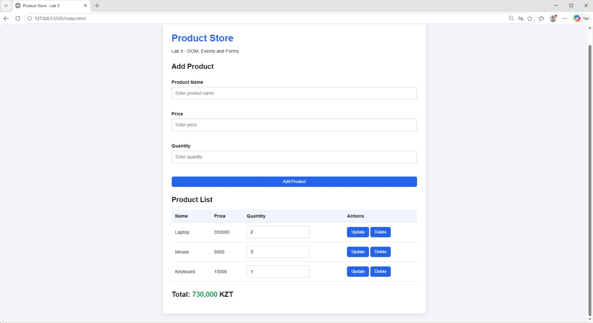

# Lab 5 — DOM, Events and Forms

**Student:** Zhumabay Nurahmet  
**Group:** IT1-2310

## Project Description

This project is an interactive product store built with HTML, CSS, and JavaScript. It uses the Store class from Lab 4 to manage products.

## Features

- Display products from the Store class.
- Add products using a form.
- Validate product name, price, and quantity.
- Show validation errors next to input fields.
- Delete products.
- Update product quantities.
- Automatically calculate the total price.
- Use event delegation for product buttons.

## How to Run

1. Download or clone the repository.
2. Open the project folder in VS Code.
3. Open `index.html` using Live Server.
4. Use the form and buttons to manage products.

## Events

I used the submit event to handle the product form without reloading the page.
I used the click event with event delegation on the product list to handle Update and Delete buttons.
The preventDefault() method stops the form from reloading the page.
After adding, updating, or deleting a product, I call renderProducts() to update the DOM and recalculate the total price.

## Technologies

- HTML5
- CSS3
- JavaScript (ES6)
- DOM API

## AI Tools

I used ChatGPT to help write, explain, and debug the code.

## Screenshot

